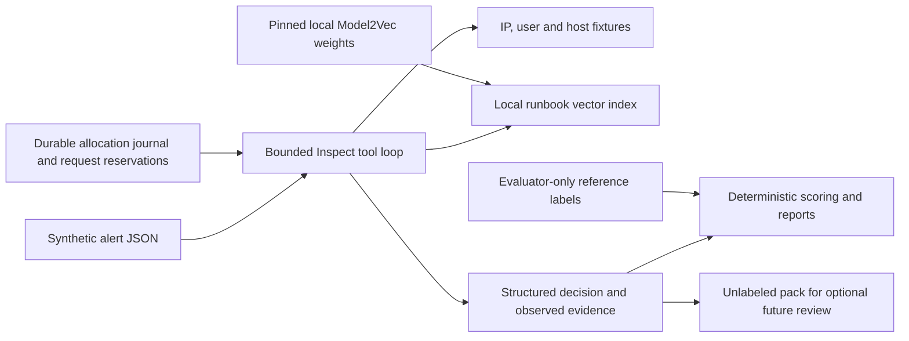

# SOC triage evaluations

This project pairs an AI security-alert agent with an evaluation system that scores decisions, runs automated checks, and preserves evidence. The first run exposed a harness gap: Haiku wrapped all 16 answers in Markdown and failed the required JSON format. We fixed the harness to enforce the same JSON schema for both providers and reran the slice while preserving the original evidence. Each model then returned 16 valid outputs but matched only 15 reference decisions, with additional severity and technique errors and unnecessary tool calls. Real-world SOC performance and whether every explanation is supported by its evidence remain unvalidated.

**Project status:** the engineering portfolio milestone is complete for the authorized 16-alert slice. Semantic faithfulness calibration is **pending, not performed, and optional future research**; it is not a portfolio completion gate or an assigned task for Joshua. See the [current scope and acceptance decision](docs/PROJECT_STATUS.md).

Python 3.12, MIT license. The implemented slice has four deterministic tools, 30 original runbooks, local semantic retrieval, native Inspect execution, scoring and regression checks. Both live runs are preserved. Full dataset expansion and the frozen comparison remain deferred and require separate authorization.



Run the complete offline evaluation with one command, after installing [uv](https://docs.astral.sh/uv/getting-started/installation/):

```bash
bash scripts/evaluate.sh
```

The first setup downloads checksum-pinned, MIT-licensed [Model2Vec weights](https://huggingface.co/minishlab/potion-base-2M) from a fixed revision. Evaluation then uses local files with network access disabled for the embedding library. No provider key is needed for the offline suite. Outputs are in `artifacts/offline/` and native Inspect JSON logs in `artifacts/recorded/inspect/`. Tested compatibility pins and the JSON log-format choice are documented in [runtime compatibility](docs/DEPENDENCIES.md).

The first prompt-only run exposed a harness gap: Haiku wrapped all 16 answers in Markdown and failed the strict JSON contract. Both providers now receive the same native output schema. **The same-slice rerun produced 16/16 valid outputs and 15/16 reference-action matches for each model.** Neither result establishes quality on a full test split. See [FINDINGS.md](FINDINGS.md) for both runs, three full raw examples, request-level proof, remaining retrieval/metric limitations and the historical cost correction. The [preserved 20-response candidate calibration pack](evidence/vertical-slice-2026-11-12-structured-rerun/human-calibration.json) remains entirely unlabeled; no reviewer is assigned.

Offline fixtures exercise all four real tool implementations and the scoring pipeline. Their perfect target-label matches are prewritten expectations and carry **no claim about model performance**. See [FINDINGS.md](FINDINGS.md), [DATASET.md](DATASET.md), and the committed [fixture baseline](baselines/offline.json).

The model receives alert fields and tool results. Synthetic reference labels, tool policies, and required-summary facts are stored separately and read only by the evaluator. IP, user, and host lookups are fake and deterministic. `runbook_search` embeds the query locally and searches an in-memory cosine vector index. Runbooks are generic guidance rather than alert answer keys. The loop allows at most six tool calls, five generations, and 1,024 output tokens per generation.

Scoring covers expected triage action and its confusion matrix; an event-truth error-cost policy that penalizes false-benign malicious events most; severity accuracy, within-one rate and MAE; acceptable ATT&CK IDs; tool necessity and waste; mechanical citation validity; and live token-cost estimates and end-to-end latency. Semantic faithfulness has a written rubric but remains uncalibrated. Its validation checks prevent an unsupported calibration claim; they do not gate engineering-portfolio completion. Citation validity does not establish faithfulness.

**Further live runs are currently held pending reconciliation of the original unrecorded probe usage**; see the [budget record](docs/BUDGET.md). Live runs use manual GitHub Actions only. Add repository secrets `OPENAI_API_KEY` and `ANTHROPIC_API_KEY`, then select **Actions → Bounded live development slice → Run workflow** on `main`. The fixed development configurations are prompt `v1` with `openai/gpt-6-luna` and `anthropic/claude-haiku-4-5-20251001`. The former is an alias; returned model identity is retained. This run is exploratory development evidence, not the later two-prompt frozen comparison.

Before requesting either model, the workflow commits a nonrefundable $5 allocation to [.budget/allocations.json](.budget/allocations.json). Allocations cannot exceed $20 total; failed or interrupted runs retain their allocation. Each request also reserves a conservative maximum in SQLite before dispatch; uncertain requests retain that reservation. Automatic model retries are disabled. Conservative accounting exceeds declared standard-service token rates; reported token costs remain estimates until billing is reconciled. These controls apply to this project's workflow and do not cap unrelated account use. See [budget design](docs/BUDGET.md).

Pull requests and pushes run the entire 16-case offline fixture suite, native Inspect task, and fixed metric regression baseline with no paid requests. An exact mismatch fails the deterministic baseline check. The paid workflow has no automatic trigger. Source dependencies, embedding revision, source hashes, observed tools, model usage, and run identity are retained for review.

## How this was built

Joshua Jordan set the project objective and scope, directed AI-assisted engineering, reviewed the results, and authorized the public release and spending limits. This portfolio demonstrates evaluation engineering and makes no claim that he is an independent SOC analyst or source of SOC-domain ground truth. OpenAI Codex coding agents implemented this original repository: the coordinating agent, `soc_clean_agent` (agent/tools/retrieval/Inspect), `soc_clean_data` (synthetic data/runbooks and budget review), and `soc_clean_evals` (metrics/statistics/reports/calibration). The AI agents wrote development reference labels and test fixtures. The candidate calibration responses remain unlabeled; no AI labels are presented as human ground truth. No private source, private history, customer records, or employer data were imported.
